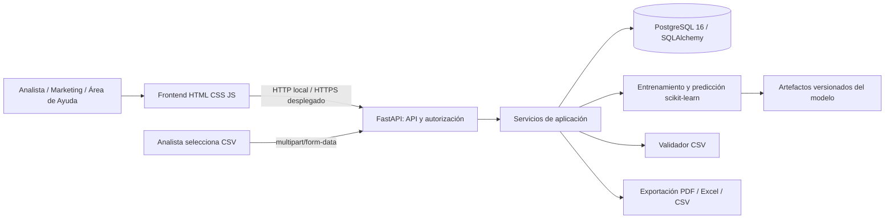

# Arquitectura tecnológica y estructura

## Línea base tecnológica

**Definido en el avance:** frontend HTML5/CSS3/JavaScript; backend Python 3.12 y FastAPI como API REST; PostgreSQL 16 con SQLAlchemy; scikit-learn (`RandomForestClassifier`, `DecisionTreeClassifier`), pandas y joblib; APScheduler para tareas futuras; openpyxl y ReportLab para exportaciones; Lucide para iconos. **Implementado actualmente:** HU01 recibe una captura CSV seleccionada manualmente por el Analista; todavía no hay consulta automática a WUF ni programación periódica. El archivo H01 estandarizado con 189 registros es dataset de referencia/desarrollo, no debe asumirse como dataset productivo vivo.

## Arquitectura de tres capas

La separación acordada mantiene las tres capas: **presentación** (`frontend/public/`), **aplicación** (API FastAPI, autorización y servicios de caso de uso) y **datos** (repositorios/infraestructura y PostgreSQL 16). El validador CSV es un adaptador de entrada de la capa de aplicación; no reemplaza ninguna capa. El navegador nunca se conecta directamente a PostgreSQL.



El navegador es cliente sin secretos ni lógica autoritativa. La API valida la sesión, permisos, entrada y estado de negocio. Los servicios de dominio no dependen de HTTP ni de componentes visuales. Los adaptadores aíslan PostgreSQL, CSV locales, filesystem/artefactos y exportadores.

## Componentes backend

- **Identidad y autorización:** autenticación, usuario, rol y comprobación de permiso por endpoint/acción.
- **Catálogo:** cliente de fuente, normalización, captura idempotente y registro de ejecuciones.
- **Dataset:** selección de snapshots, creación de etiqueta, codificación reproducible, exportación y versiones.
- **ML:** entrenamiento/evaluación, registro de métricas, activación explícita del modelo y predicciones reproducibles.
- **Consistencia/alertas:** evaluación del riesgo, explicación, deduplicación, persistencia y atención.
- **Reportes/KPI:** consulta de datos consistentes, reglas versionadas y exportaciones.
- **Configuración/auditoría:** umbrales editables con permiso, bitácora de cambios y eventos operativos.

## API propuesta (nombres de recurso; validar contrato al implementar)

| Área | Rutas sugeridas | Permiso |
|---|---|---|
| Sesión | `POST /api/v1/auth/login`, `POST /api/v1/auth/logout`, `GET /api/v1/auth/me` | Público solo login; autenticado resto |
| Catálogo | `GET /api/v1/pets`, `GET /api/v1/pets/{id}` | Tres roles |
| Capturas | `POST /api/v1/collection-runs`, `GET /api/v1/collection-runs` | Analista |
| Dataset | `POST /api/v1/datasets`, `GET /api/v1/datasets`, `GET /api/v1/datasets/{id}/export` | Analista |
| Modelos | `POST /api/v1/models/train`, `GET /api/v1/models`, `POST /api/v1/models/{id}/activate` | Analista |
| Alertas | `GET /api/v1/alerts`, `PATCH /api/v1/alerts/{id}` | Analista/Ayuda según acción |
| Reportes | `POST /api/v1/reports`, `GET /api/v1/reports`, `GET /api/v1/reports/{id}/file` | Analista/Marketing |
| Indicadores | `GET /api/v1/indicators?from=&to=` | Tres roles |
| Configuración | `GET/PATCH /api/v1/settings` | Lectura autenticada; escritura Analista |

Respuestas de error estables, paginación y filtros tipados deben ser comunes. No devolver rutas locales de artefactos ni trazas internas.

## Flujo de HU y transacciones

1. El Analista selecciona un archivo CSV en la interfaz y lo envía al backend como `multipart/form-data`; no se envía una ruta del equipo ni se escanea automáticamente una carpeta.
2. El backend crea `ejecucion_recoleccion` y registra actor, fechas de procesamiento, semana de captura, estado, contadores, nombre de archivo y errores resumidos. Actualmente la fecha/semana se toma al importar; antes de HU02 deberá recibirse y validarse la fecha de captura del CSV y calcularse su semana ISO. Aplica el límite de bytes y valida encabezados, tipos, dominios, longitudes y SKU duplicados. Una captura parcial se declara parcial y no se presenta como completa.
3. Actualizar `mascota` como estado vigente y guardar una copia de todos los atributos en `snapshot_catalogo`, ligada a ejecución y mascota. Guardar las etiquetas en `snapshot_etiqueta_condicion`; la unicidad por ejecución/mascota hace idempotente el guardado.
4. Construir dataset desde snapshots identificables y política de etiquetas versionada; persistir metadatos y hash/versión del CSV.
5. Entrenar con pipeline de preprocesamiento y semilla reproducible. Evaluar holdout y validación adecuada; registrar parámetros, dataset, métricas y artefacto. Activar solo al cumplir criterios configurados.
6. Generar predicciones con id de modelo, fecha y probabilidad calibrada/interpretada; la prioridad deriva de configuración versionada.
7. Evaluar consistencia, crear alertas idempotentes; permitir atención y auditoría.
8. Reportes y dashboard se construyen desde datos persistidos y exponen periodo, fecha de cálculo y versión/regla usada.

## Estructura objetivo propuesta

La siguiente estructura es la guía para completar el producto al avanzar por las HU. **Es una propuesta futura, no una descripción de carpetas que deban existir ya.** Se actualizará al cierre del proyecto para reflejar lo que finalmente se implemente.

```text
WUF_PREDICT/
├── docs/                         # Requisitos, arquitectura, manuales y decisiones
├── prototipo/                    # Referencia estática original
├── frontend/                     # Cliente web por historias de usuario
│   ├── src/
│   │   ├── api/                  # Cliente HTTP y contratos de API
│   │   ├── auth/                 # Sesión y control de navegación por rol
│   │   ├── components/           # Componentes compartidos
│   │   ├── pages/                # Vistas por módulo/HU
│   │   └── styles/               # Estilos y tokens visuales
│   └── public/                   # Recursos estáticos y configuración local
├── backend/
│   ├── app/
│   │   ├── api/v1/               # routers y endpoints versionados
│   │   ├── core/                 # configuración tipada y seguridad
│   │   ├── domain/               # reglas y entidades del dominio
│   │   ├── services/             # casos de uso por módulo
│   │   ├── infrastructure/      # PostgreSQL, CSV y almacenamiento
│   │   └── main.py               # aplicación FastAPI y middleware
│   ├── scripts/                  # administración reproducible
│   ├── migrations/               # migraciones versionadas del esquema
│   ├── tests/                    # pruebas unitarias e integración
│   ├── schema.sql                # esquema base para instalación nueva
│   ├── .env.example              # nombres de configuración sin secretos
│   └── pyproject.toml
├── data/
│   └── capturas/                 # CSV de demostración o importación local
├── artifacts/                    # modelos y artefactos versionados/controlados
├── scripts/                      # tareas de soporte del proyecto
├── .env.example                  # configuración general de ejemplo
├── .gitignore
└── README.md                     # inicio rápido y enlaces a documentación
```

### Estructura que existe ahora

Actualmente hay `docs/`, `prototipo/`, `frontend/public/`, `backend/app/` (api, core, domain, services e infrastructure), `backend/scripts/`, `backend/tests/`, los scripts SQL incrementales, `data/capturas/` y `.gitignore`. No están creadas aún `frontend/src/`, `backend/migrations/`, `artifacts/`, `scripts/` en la raíz ni `README.md` en la raíz. Para HU01, el backend no consulta WUF, no escanea `data/capturas` ni usa `mascota` como fuente de entrada. La estructura objetivo se irá materializando solo cuando las HU correspondientes lo requieran.

## Esquema objetivo `wuf_predict_v2`

Para HU02 se preparó [`../backend/schema_wuf_predict_v2.sql`](../backend/schema_wuf_predict_v2.sql), derivado del diccionario físico original. Añade fecha de captura separada de la importación y relaciones versionadas entre dataset, ejecuciones y snapshots. El objetivo de etiqueta se almacena en los detalles del dataset (`permanece`, `salio_catalogo`, `indeterminada`), mientras el estado observado permanece en cada snapshot. Este SQL no migra ni borra la base `wuf_predict`.

El repositorio reconoce el esquema HU01 anterior y v2; `CsvCatalogSource` valida la fecha desde el nombre del archivo, y el guardado comprueba mascota/SKU/snapshot/ejecución antes de confirmar. Consulta [`03-modelo-datos.md`](03-modelo-datos.md) para la migración complementaria y la política de comparación.

## HU01 implementada

- Login con Argon2 y JWT de vida limitada; rol cargado desde PostgreSQL en cada solicitud; captura e historial protegidos para Analista.
- `POST /api/v1/collection-runs`, `GET /api/v1/collection-runs`, `GET /api/v1/collection-runs/overview`; sesión y perfil en `/api/v1/auth/login` y `/api/v1/auth/me`.
- Recolección manual de un archivo CSV elegido por el Analista.
- `CsvCatalogSource` valida el CSV UTF-8 recibido por la API; no lee la carpeta del servidor. `CollectionRepository` reconcilia y actualiza `mascota` por SKU y crea un snapshot completo por ejecución.
- `etiqueta_adoptado` es opcional únicamente para compatibilidad con CSV antiguos: el importador actual lo descarta y guarda NULL. HU02 deriva “Permanece / Salió del catálogo” al comparar snapshots. La etiqueta de salida es un proxy y no crea una fila en `adopcion` ni confirma una adopción real.
- `(id_ejecucion, id_mascota)` evita duplicar una mascota en una ejecución. El mismo SKU entre distintos CSV conserva la identidad e historial; no se debe cambiar ni reutilizar el SKU para otro animal.

## Despliegue mínimo

Separar configuración local, pruebas, staging y producción; PostgreSQL no se expone al navegador. HTTPS en despliegue; backup/restauración de DB y artefactos; health/readiness; logs estructurados sin credenciales ni datos personales. La ejecución programada es una capacidad futura: antes de habilitarla habrá que definir fuente, calendario y control de duplicados.
