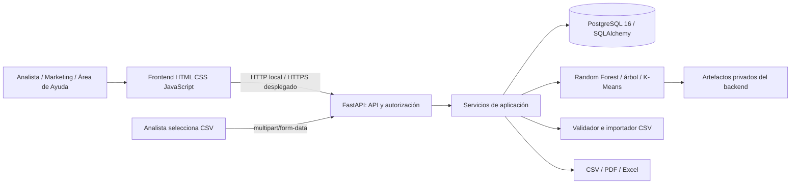

# Arquitectura tecnológica y estructura realizada

## Línea base tecnológica

La aplicación usa HTML, CSS y JavaScript sin framework en `frontend/public/`; Python 3.12 o 3.13, FastAPI, SQLAlchemy y PostgreSQL 16 en el backend; y pandas, scikit-learn y joblib para los componentes de aprendizaje automático. Las exportaciones PDF y Excel usan ReportLab y openpyxl. La configuración local se lee desde `backend/.env`, que no se versiona. No hay scraping ni ejecución semanal automática: el Analista importa manualmente cada CSV.

La base configurada actualmente es `wuf_predict_db` y su instalador íntegro es [`../backend/schema_wuf_predict_db.sql`](../backend/schema_wuf_predict_db.sql), con 20 tablas. Los demás `schema_*.sql` y `upgrade_*.sql` del backend se conservan como antecedentes de desarrollo; no son pasos requeridos para iniciar esta instalación limpia.

## Arquitectura de tres capas

La separación implementada mantiene tres capas: **presentación** (`frontend/public/`), **aplicación** (API FastAPI, autorización y servicios) y **datos** (repositorios, SQLAlchemy y PostgreSQL). El navegador no se conecta directamente a PostgreSQL.



La API comprueba sesión, rol, formato y reglas de negocio. Los servicios coordinan los casos de uso y los repositorios acceden a PostgreSQL. Los archivos de artefactos se guardan fuera del webroot y no se incluyen en Git.

## Componentes implementados

- **Identidad y permisos:** login, perfil autenticado, roles por endpoint y verificación de contraseña con Argon2.
- **Recolección (HU01):** importación manual de CSV, validación, conciliación por SKU y creación de snapshots históricos.
- **Dataset histórico (HU02):** elección de capturas de inicio/fin, comparación de evidencia, etiqueta proxy, versionado y exportación CSV.
- **Predicción de adopción (HU03/OE1):** Random Forest, evaluación, publicación controlada y predicciones para el catálogo vigente.
- **Consistencia y alertas (HU04/HU07/OE2):** árbol de decisión que aproxima la regla provisional; bandeja de alertas de prioridad alta y registro de atención humana.
- **Reporte y segmentación (HU05/HU06/OE3):** reporte a demanda con resultados OE1 y OE3 en secciones separadas; K-Means agrupa las mascotas disponibles y el reporte señala cuáles cumplen criterios de perfil desfavorecido.
- **Dashboard (HU08):** consulta datos persistidos, metas y actividad reciente sin calcular ni alterar resultados de otros módulos.
- **Configuración de cuenta:** cada usuario puede guardar su nombre y cambiar su contraseña; el correo se muestra deshabilitado. La preferencia de tema se guarda en el navegador. No se exponen parámetros técnicos ni una pantalla de gestión de roles.

## API implementada

Todas las rutas de negocio usan el prefijo `/api/v1`. El login no requiere una sesión previa; las demás rutas requieren autenticación y sus permisos se comprueban en el backend.

| Área | Rutas implementadas | Acceso principal |
|---|---|---|
| Sesión y cuenta | `POST /auth/login`, `GET /auth/me`, `PATCH /auth/me`, `POST /auth/change-password` | Login público; las otras requieren sesión propia |
| Capturas | `POST/GET /collection-runs`, `GET /collection-runs/overview` | Analista |
| Dataset | `GET /datasets`, `GET /datasets/sources`, `POST /datasets`, `GET /datasets/{id}`, `GET /datasets/{id}/export` | Analista |
| Random Forest y catálogo | `GET /models`, `GET /models/options`, `GET /models/predictions`, `POST /models/train`, `POST /models/{id}/activate`, `POST /models/{id}/refresh-predictions` | Entrenamiento: Analista; predicciones: Analista/Marketing |
| Árbol de consistencia | `GET /consistency/latest`, `GET /consistency/history/{id}`, `POST /consistency/train` | Consulta: Analista/Área de Ayuda; entrenamiento: Analista |
| Alertas | `GET /alerts`, `PATCH /alerts/{id}/attention` | Consulta: Analista/Área de Ayuda; atención: Área de Ayuda |
| Reportes | `GET /reports/current`, `GET /reports/history`, `POST /reports/export`, `GET /reports/history/{id}/export` | Analista/Marketing |
| K-Means | `GET /segmentation/options`, `GET /segmentation/models`, `GET /segmentation/models/{id}/scatter`, `POST /segmentation/models/train`, `POST /segmentation/models/{id}/activate`, `POST /segmentation/models/current/refresh` | Analista |
| Dashboard | `GET /dashboard/summary` | Usuarios autenticados |

La configuración usa las rutas de cuenta existentes; no hay una tabla ni interfaz de parámetros generales. No se devuelve al navegador una ruta local de artefactos ni una traza interna.

## Flujo de los módulos

1. El Analista elige y envía un CSV. El backend valida contenido y nombre, registra la ejecución, actualiza la identidad vigente de la mascota y guarda el snapshot asociado.
2. HU02 compara las capturas completas del periodo elegido. Una salida del catálogo es una etiqueta proxy, no una adopción confirmada.
3. HU03 entrena y evalúa Random Forest. Una publicación explícita genera o actualiza predicciones para los perfiles disponibles de la captura vigente.
4. HU04 calcula prioridad de revisión con una regla operativa y entrena un árbol para aproximarla. La prioridad de la regla, no la predicción del árbol, alimenta la generación de alertas HU07.
5. El Área de Ayuda atiende las alertas; cada cambio conserva actor, fecha y nota.
6. HU06 entrena K-Means con los perfiles disponibles y activa una asignación para una captura. Los criterios de perfil desfavorecido se calculan aparte y no alteran el agrupamiento.
7. HU05 presenta y exporta bajo demanda dos resultados: prioridad OE1 basada en Random Forest y grupos OE3 basados en K-Means. HU08 resume los datos guardados.

## Estructura realizada

La siguiente estructura corresponde al repositorio actual. Los esquemas y upgrades históricos se mantienen como referencias; la instalación limpia vigente es `backend/schema_wuf_predict_db.sql`.

```text
WUF_PREDICT/
├── docs/                         # Requisitos, arquitectura, guías HU y decisiones
├── prototipo/                    # Referencia visual estática
├── frontend/
│   └── public/
│       ├── app.js                # Navegación, API y comportamiento de vistas
│       ├── config.js.example     # Configuración de API para el navegador
│       ├── index.html            # Vistas del sistema
│       └── styles.css            # Estilos responsive
├── backend/
│   ├── app/
│   │   ├── api/v1/               # Rutas HTTP por módulo
│   │   ├── core/                 # Configuración y seguridad
│   │   ├── domain/               # Reglas de negocio y preparación ML
│   │   ├── infrastructure/       # DB, repositorios, CSV y artefactos
│   │   ├── services/             # Casos de uso
│   │   └── main.py               # Aplicación FastAPI
│   ├── migrations/               # SQL de evolución histórica; no se usa al instalar la base limpia
│   ├── scripts/create_user.py    # Alta inicial de usuario
│   ├── tests/                    # Pruebas automatizadas existentes
│   ├── .env.example              # Plantilla sin secretos
│   ├── pyproject.toml            # Dependencias y configuración Python
│   └── schema_wuf_predict_db.sql # Instalador limpio vigente de 20 tablas
├── data/capturas/                # CSV demo; el usuario elige los archivos al importarlos
├── artifacts/models/            # Artefactos ML locales, ignorados por Git
├── scripts/                      # Generadores de CSV demo
└── .gitignore
```

El frontend se mantiene en archivos estáticos dentro de `frontend/public/`; no existe `frontend/src/`. Los datos de ejemplo actuales están en `data/capturas/escenario_hu02_variable_v4/`. La carpeta de capturas no se escanea automáticamente.

## Base de datos y configuración

Para una instalación nueva se crea una base vacía y se ejecuta una sola vez [`../backend/schema_wuf_predict_db.sql`](../backend/schema_wuf_predict_db.sql). El script no crea ni elimina bases PostgreSQL. Después se configura `DATABASE_URL` en `backend/.env` con la base deseada; en el entorno actual apunta a `wuf_predict_db`. Los scripts `upgrade_*.sql` y los instaladores versionados anteriores son para el historial de desarrollo y no forman parte de ese procedimiento.

Los parámetros técnicos, CORS, límites, seguridad, ubicación de artefactos y metas del Dashboard se configuran en el entorno del backend. El correo no se edita en la pantalla de Configuración; tampoco se administran roles o permisos desde esa pantalla.

## Límites de alcance

El catálogo se simula con CSV manuales, no con extracción automática de WUF. Las etiquetas HU02 y los datos de demostración no prueban adopciones reales. HU04 usa prioridades de revisión provisionales, no una verificación externa del estado. El Dashboard muestra metas de negocio y datos operativos disponibles, pero no afirma que las metas estratégicas se hayan alcanzado. Los artefactos generados localmente deben conservarse junto con su metadata si se requiere reproducir una publicación.
