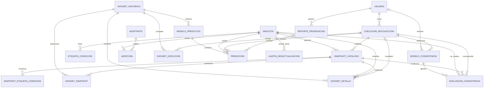

# Guía sencilla de las tablas de WUF Predict

## Alcance

Esta guía describe las **18 tablas** del esquema que se instala en `wuf_predict_v5` con [`../backend/schema_wuf_predict_v4.sql`](../backend/schema_wuf_predict_v4.sql). El nombre del archivo conserva la versión del esquema; la base vigente del proyecto se llama `wuf_predict_v5`.

Una **PK** identifica una fila. Una **FK** conecta una fila con otra tabla y protege esa relación. Por ejemplo, un snapshot guarda el ID de la mascota y de la ejecución que lo produjo.

## Tablas, agrupadas por función

### Usuarios y datos de referencia

| Tabla | ¿Para qué sirve? | Relaciones principales |
|---|---|---|
| `usuario` | Guarda las cuentas de acceso: nombre, correo, rol y hash de contraseña. | Puede iniciar muchas `ejecucion_recoleccion`, generar muchos `reporte_priorizacion` y figurar como responsable de versiones HU04. |
| `mascota` | Mantiene la identidad estable por SKU y sus datos descriptivos actuales. | Una mascota puede tener etiquetas, aparecer en muchos snapshots y relacionarse con adopciones, predicciones, alertas y evaluaciones HU04. |
| `etiqueta_condicion` | Guarda las etiquetas estandarizadas asociadas actualmente a una mascota. | Cada etiqueta pertenece a una `mascota`; no se repite la misma etiqueta para la misma mascota. |
| `adoptante` | Representa a la persona que recibe una mascota en el diseño de datos. | Puede relacionarse con varias filas de `adopcion`. El flujo CSV y el entrenamiento actual no cargan datos de adoptantes. |
| `adopcion` | Registra una adopción con mascota, adoptante, fecha, costo y estado. | Cada fila apunta a una `mascota` y un `adoptante`. La salida de catálogo usada por HU02 no crea una adopción aquí ni confirma que haya ocurrido. |

### Recolección e historial del catálogo — HU01

| Tabla | ¿Para qué sirve? | Relaciones principales |
|---|---|---|
| `ejecucion_recoleccion` | Registra cada importación CSV: quién la inició, fecha representada, semana ISO, archivo, estado y conteos. | Puede pertenecer a un `usuario`; agrupa snapshots y puede ser fuente de datasets, predicciones y evaluaciones HU04. |
| `snapshot_catalogo` | Guarda la ficha de una mascota tal como apareció en una captura. Conserva atributos y estado de esa fecha aunque cambien después en `mascota`. | Cada snapshot apunta a una `mascota` y una `ejecucion_recoleccion`; puede participar en datasets y evaluaciones. |
| `snapshot_etiqueta_condicion` | Guarda las etiquetas de condición observadas en un snapshot específico. | Une `snapshot_catalogo` con una etiqueta de texto; su clave está formada por snapshot y etiqueta. |

**Idea clave:** `mascota` representa la identidad del animal; `snapshot_catalogo` conserva sus distintas versiones en el tiempo. Las tres capturas CSV de una misma mascota producen tres snapshots relacionados con su SKU.

### Dataset etiquetado — HU02

| Tabla | ¿Para qué sirve? | Relaciones principales |
|---|---|---|
| `dataset_historico` | Registra una versión del dataset: fechas incluidas, número de filas, origen de etiquetas, regla y hash opcional. | Es la cabecera de sus filas y se relaciona con los modelos predictivos entrenados a partir de él. |
| `dataset_snapshot` | Relaciona qué snapshots se incluyeron como evidencia en cada dataset. | Es la unión muchos-a-muchos entre `dataset_historico` y `snapshot_catalogo`. Un snapshot puede reutilizarse en varias versiones del dataset. |
| `dataset_ejecucion` | Registra todas las ejecuciones consideradas para comparar un dataset, incluso si una mascota estuvo ausente de una captura completa. | Es la unión entre `dataset_historico` y `ejecucion_recoleccion`. |
| `dataset_detalle` | Guarda una observación por mascota y dataset: snapshot de referencia, evidencia de resultado, etiqueta derivada y motivo si es indeterminada. | Apunta a `dataset_historico`, `mascota`, snapshots y, cuando aplica, a la ejecución del resultado. |

`dataset_detalle.etiqueta_catalogo` puede ser `permanece`, `salio_catalogo` o `indeterminada`. La salida del catálogo es una etiqueta proxy usada por el entrenamiento, no una adopción confirmada.

### Modelo de adopción, predicciones e informes — HU03 y HU05

| Tabla | ¿Para qué sirve? | Relaciones principales |
|---|---|---|
| `modelo_predictivo` | Conserva cada versión de Random Forest, dataset de origen, métricas, parámetros, estado y referencia/hash del artefacto. | Cada modelo se entrena con un `dataset_historico` y puede producir muchas predicciones. |
| `prediccion` | Guarda probabilidad estimada, prioridad, fecha, mascota, modelo y ejecución evaluada. | Apunta a `modelo_predictivo`, `mascota` y opcionalmente a `ejecucion_recoleccion` y `reporte_priorizacion`. Una predicción normal tiene `id_reporte` vacío; al exportar, se copia y queda asociada a un reporte. |
| `reporte_priorizacion` | Registra cada exportación de HU05: usuario, semana ISO, fecha y formato PDF o Excel. | Pertenece a un `usuario`; sus filas históricas se relacionan mediante las copias de `prediccion` con `id_reporte`. |

El catálogo y el reporte consultan las predicciones del modelo vigente ligadas a la última captura completa. El historial de informes recupera las filas guardadas para regenerar una descarga anterior.

### Revisión de consistencia y alertas — HU04 y HU07

| Tabla | ¿Para qué sirve? | Relaciones principales |
|---|---|---|
| `modelo_consistencia` | Versiona el árbol de decisión de HU04, su ejecución de referencia, métricas, variables, reglas, parámetros y artefacto. | Puede registrar el `usuario` que lo entrenó y apunta a `ejecucion_recoleccion`; tiene muchas evaluaciones. |
| `evaluacion_consistencia` | Guarda la prioridad de revisión por mascota en una captura, más la justificación e indicadores. | Conecta `modelo_consistencia`, `mascota`, `snapshot_catalogo` y `ejecucion_recoleccion`. |
| `alerta_desactualizacion` | Reserva persistencia para notificaciones de perfiles que requieren atención, prevista para HU07. | Apunta a una `mascota`. Actualmente HU04 guarda sus resultados en `evaluacion_consistencia`; no los inserta en esta tabla como alertas atendidas. |

La prioridad de revisión que muestra HU04 se calcula con una regla directa y provisional. El árbol de decisión aprende a aproximarla; sus métricas no prueban que el estado real del catálogo sea correcto o incorrecto.

## Relaciones principales de un vistazo

Las tablas de unión —`dataset_snapshot` y `dataset_ejecucion`— resuelven relaciones muchos-a-muchos. `dataset_detalle` es distinta: guarda el resultado etiquetado de comparar la evidencia del dataset para cada mascota.

## Recorrido típico por módulos

1. **HU01:** se registra una importación en `ejecucion_recoleccion`; cada perfil genera un `snapshot_catalogo` relacionado con `mascota`.
2. **HU02:** se crea `dataset_historico`, se enlazan ejecuciones y snapshots, y se guardan las etiquetas por mascota en `dataset_detalle`.
3. **HU03:** `modelo_predictivo` registra el Random Forest; `prediccion` guarda sus probabilidades para mascotas disponibles.
4. **HU04:** `modelo_consistencia` registra una versión del árbol y `evaluacion_consistencia` guarda las prioridades de revisión por perfil.
5. **HU05:** `reporte_priorizacion` registra la exportación; las copias de predicciones conservan el contenido asociado al reporte.
6. **HU07 (previsto):** `alerta_desactualizacion` podrá registrar notificaciones y su estado de atención.

## Qué no significa la presencia de una tabla

El esquema incluye `adoptante`, `adopcion` y `alerta_desactualizacion` por el modelo de dominio y los módulos posteriores. Su existencia no significa que los CSV actuales tengan datos de adopción real ni que HU04 ya genere alertas de HU07. Para interpretar el estado implementado de cada módulo, consulta [`04-modulos-hu.md`](04-modulos-hu.md).
