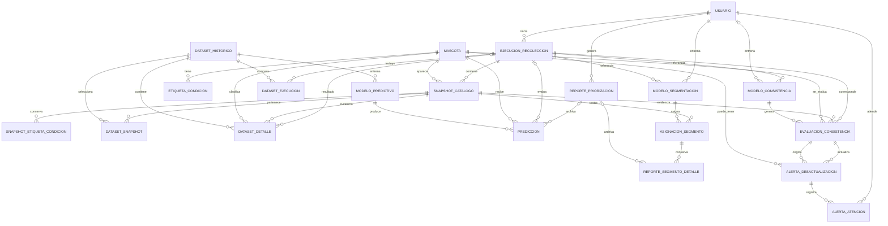

# Guía sencilla de las tablas de WUF Predict

## Alcance

Esta guía describe las **20 tablas** del instalador final [`../backend/schema_wuf_predict_db.sql`](../backend/schema_wuf_predict_db.sql), para PostgreSQL 16. Conserva las estructuras usadas por HU01–HU08, agrega copias de los nombres de responsables para que el historial no cambie al editar un perfil y omite dos tablas del diseño antiguo que el sistema actual no utiliza.

La base configurada actualmente es `wuf_predict_db` y usa estas 20 tablas del instalador limpio. Los archivos SQL versionados y las migraciones que siguen en el repositorio son antecedentes de desarrollo, no instrucciones para la base actual. Para una instalación nueva, ejecuta `schema_wuf_predict_db.sql` solo sobre una base vacía; el script no crea ni borra bases.

Una **PK** identifica una fila. Una **FK** conecta una fila con otra tabla y protege esa relación. Por ejemplo, un snapshot guarda el ID de la mascota y de la ejecución que lo produjo.

## Tablas, agrupadas por función

### Usuarios y datos de referencia

| Tabla | ¿Para qué sirve? | Relaciones principales |
|---|---|---|
| `usuario` | Guarda las cuentas de acceso: nombre, correo, rol y hash de contraseña. | Puede iniciar muchas `ejecucion_recoleccion`, generar reportes y figurar como responsable de versiones HU04 u OE3. |
| `mascota` | Mantiene la identidad estable por SKU y sus datos descriptivos actuales. | Una mascota puede tener etiquetas, aparecer en muchos snapshots y relacionarse con predicciones, alertas y evaluaciones HU04. |
| `etiqueta_condicion` | Guarda las etiquetas estandarizadas asociadas actualmente a una mascota. | Cada etiqueta pertenece a una `mascota`; no se repite la misma etiqueta para la misma mascota. |

### Recolección e historial del catálogo — HU01

| Tabla | ¿Para qué sirve? | Relaciones principales |
|---|---|---|
| `ejecucion_recoleccion` | Registra cada importación CSV: quién la inició, fecha representada, semana ISO, archivo, estado y conteos. | Puede pertenecer a un `usuario`; agrupa snapshots y puede ser fuente de datasets, predicciones y evaluaciones HU04. |
| `snapshot_catalogo` | Guarda la ficha de una mascota tal como apareció en una captura. Conserva atributos y estado de esa fecha aunque cambien después en `mascota`. | Cada snapshot apunta a una `mascota` y una `ejecucion_recoleccion`; puede participar en datasets y evaluaciones. |
| `snapshot_etiqueta_condicion` | Guarda las etiquetas de condición observadas en un snapshot específico. | Une `snapshot_catalogo` con una etiqueta de texto; su clave está formada por snapshot y etiqueta. |

**Idea clave:** `mascota` representa la identidad del animal; `snapshot_catalogo` conserva sus distintas versiones en el tiempo. Las tres capturas CSV de una misma mascota producen tres snapshots relacionados con su SKU.

### Dataset etiquetado — HU02

| Tabla | ¿Para qué sirve? | Relaciones principales |
|---|---|---|
| `dataset_historico` | Registra una versión del dataset: fechas incluidas, número de filas, origen de etiquetas, regla y hash opcional. | Es la cabecera de sus filas y se relaciona con los modelos predictivos entrenados a partir de él. |
| `dataset_snapshot` | Relaciona qué snapshots se incluyeron como evidencia en cada dataset. | Es la unión muchos-a-muchos entre `dataset_historico` y `snapshot_catalogo`. Un snapshot puede reutilizarse en varias versiones del dataset. |
| `dataset_ejecucion` | Registra todas las ejecuciones consideradas para comparar un dataset, incluso si una mascota estuvo ausente de una captura completa. | Es la unión entre `dataset_historico` y `ejecucion_recoleccion`. |
| `dataset_detalle` | Guarda una observación por mascota y dataset: snapshot de referencia, evidencia de resultado, etiqueta derivada y motivo si es indeterminada. | Apunta a `dataset_historico`, `mascota`, snapshots y, cuando aplica, a la ejecución del resultado. |

`dataset_detalle.etiqueta_catalogo` puede ser `permanece`, `salio_catalogo` o `indeterminada`. La salida del catálogo es una etiqueta proxy usada por el entrenamiento, no una adopción confirmada.

### Modelo de adopción, predicciones e informes — HU03 y HU05

| Tabla | ¿Para qué sirve? | Relaciones principales |
|---|---|---|
| `modelo_predictivo` | Conserva cada versión de Random Forest, dataset de origen, métricas, parámetros, estado y referencia/hash del artefacto. | Cada modelo se entrena con un `dataset_historico` y puede producir muchas predicciones. |
| `prediccion` | Guarda probabilidad estimada, prioridad, fecha, mascota, modelo y ejecución evaluada. | Apunta a `modelo_predictivo`, `mascota` y opcionalmente a `ejecucion_recoleccion` y `reporte_priorizacion`. Una predicción normal tiene `id_reporte` vacío; al exportar, se copia y queda asociada a un reporte. |
| `reporte_priorizacion` | Registra cada exportación de HU05: usuario, nombre visible al exportar, semana ISO, fecha y formato PDF o Excel. | Pertenece a un `usuario`; conserva el nombre del generador como copia histórica y relaciona las filas incluidas mediante `prediccion.id_reporte`. |

En el instalador final, `reporte_priorizacion` también apunta a la ejecución y al modelo K-Means incluidos en esa exportación. Así se mantiene clara la procedencia de los dos objetivos.

### Segmentación de perfiles — OE3 / HU06

| Tabla | ¿Para qué sirve? | Relaciones principales |
|---|---|---|
| `modelo_segmentacion` | Versiona un modelo K-Means, su K, captura de referencia, Silhouette, inertia, variables/parámetros, resumen de grupos y hash del artefacto. | Apunta a `ejecucion_recoleccion` y `usuario`; tiene muchas asignaciones de perfil. Solo una versión puede ser vigente. |
| `asignacion_segmento` | Guarda el número de grupo asignado por un modelo a un `snapshot_catalogo` y los criterios HU06 observados; si no cumple ninguno, conserva una lista vacía. | Cada asignación pertenece a un `modelo_segmentacion` y snapshot; la combinación modelo/snapshot es única. |
| `reporte_segmento_detalle` | Enlaza un reporte con las asignaciones OE3 exactas que incluyó. | Une `reporte_priorizacion` y `asignacion_segmento` para poder recuperar exportaciones históricas. |

K-Means trabaja sobre todos los perfiles disponibles. Después se guardan los criterios HU06 que cumple cada perfil; estos criterios no filtran la cohorte ni determinan el segmento. No usa especie, identificadores, etiquetas de adopción ni predicciones OE1. Los grupos no son probabilidades ni clases con orden. `parametros` identifica el alcance de cohorte para distinguir los modelos nuevos de versiones históricas.

El catálogo y el reporte consultan las predicciones del modelo vigente ligadas a la última captura completa. El historial de informes recupera las filas guardadas para regenerar una descarga anterior.

### Revisión de consistencia y alertas — HU04 y HU07

| Tabla | ¿Para qué sirve? | Relaciones principales |
|---|---|---|
| `modelo_consistencia` | Versiona el árbol de decisión de HU04, su ejecución de referencia, métricas, variables, reglas, parámetros y artefacto. | Puede registrar el `usuario` que lo entrenó y apunta a `ejecucion_recoleccion`; tiene muchas evaluaciones. |
| `evaluacion_consistencia` | Guarda la prioridad de revisión por mascota en una captura, más la justificación e indicadores. | Conecta `modelo_consistencia`, `mascota`, `snapshot_catalogo` y `ejecucion_recoleccion`. |
| `alerta_desactualizacion` | Mantiene una alerta interna cuando HU04 asigna prioridad alta. Registra creación, última detección, mensaje y estado actual; enlaza la primera evaluación y la evaluación más reciente que la volvió a detectar. | Apunta a `mascota` y a `evaluacion_consistencia`. Solo puede haber una alerta abierta por mascota; al resolverse puede comenzar un episodio nuevo en una evaluación posterior. |
| `alerta_atencion` | Guarda cada acción del Área de Ayuda: estado anterior/nuevo, usuario, nombre visible al atender, fecha y nota. | Pertenece a `alerta_desactualizacion` y a `usuario`; conserva el nombre registrado en ese momento aunque el usuario cambie luego su perfil. |

La prioridad de revisión que muestra HU04 se calcula con una regla directa y provisional. El árbol de decisión aprende a aproximarla; sus métricas no prueban que el estado real del catálogo sea correcto o incorrecto. HU07 crea una alerta interna únicamente para prioridad alta. La alerta sigue siendo una solicitud de verificación humana, no una confirmación de estado obsoleto. Los días sin cambio se derivan de la secuencia observada de capturas y se conservan en los indicadores JSON de la evaluación; no representan una verificación directa en WUF.

## Relaciones principales de un vistazo

Las tablas de unión —`dataset_snapshot` y `dataset_ejecucion`— resuelven relaciones muchos-a-muchos. `dataset_detalle` es distinta: guarda el resultado etiquetado de comparar la evidencia del dataset para cada mascota.

## Recorrido típico por módulos

1. **HU01:** se registra una importación en `ejecucion_recoleccion`; cada perfil genera un `snapshot_catalogo` relacionado con `mascota`.
2. **HU02:** se crea `dataset_historico`, se enlazan ejecuciones y snapshots, y se guardan las etiquetas por mascota en `dataset_detalle`.
3. **HU03:** `modelo_predictivo` registra el Random Forest; `prediccion` guarda sus probabilidades para mascotas disponibles.
4. **HU04:** `modelo_consistencia` registra una versión del árbol y `evaluacion_consistencia` guarda las prioridades de revisión por perfil.
5. **HU05:** `reporte_priorizacion` registra la exportación; las copias de predicciones conservan el contenido asociado al reporte.
6. **HU06/OE3:** `modelo_segmentacion` registra K-Means y `asignacion_segmento` enlaza cada grupo con el snapshot de esa captura. Al exportar, `reporte_segmento_detalle` conserva las asignaciones usadas.
7. **HU07:** al guardar la evaluación HU04, `alerta_desactualizacion` registra las prioridades altas. Si el caso sigue abierto, se actualiza su última evidencia; cuando ya fue resuelto y vuelve a resultar prioritario, comienza un episodio nuevo. El Área de Ayuda registra cada transición y nota en `alerta_atencion`.

## Tablas omitidas del instalador vigente

`adoptante` y `adopcion` figuraban en el modelo conceptual inicial, pero el sistema implementado no tiene pantallas, endpoints ni consultas que las utilicen. Los CSV no contienen adoptantes ni adopciones confirmadas; la salida del catálogo es solo una etiqueta proxy para HU03. Por eso no forman parte de las 20 tablas del nuevo instalador.

En la base vigente `wuf_predict_db`, esas dos tablas no existen porque el backend no las necesita. Las alertas HU07 siguen siendo avisos de revisión humana, no confirmaciones de estado obsoleto.
